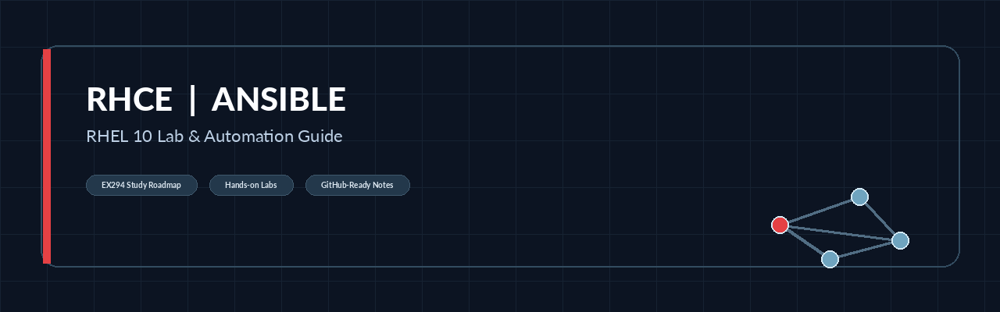

# RHCE EX294 — Ansible Automation & RHEL 10 Lab Guide



[](docs/01-ansible-fundamentals.md) [](docs/02-vmware-rhel10-lab.md) [](docs/07-playbooks.md) [](docs/08-ex294-roadmap.md)

**Practical, beginner-friendly Linux automation notes** covering a three-node VMware/RHEL lab, Ansible installation, SSH and inventory, repeatable playbooks, and guided RHCE (EX294) practice.

> [!NOTE]
> **Independent educational notes; not official Red Hat courseware.** Based on the classroom handout `Day1_10-Oct-2026-AU294.pdf` (10 October 2026), with corrections and original additions. The original handout is **not redistributed** in this repository. The Day 1 material is separate from the expanded EX294 learning roadmap. These examples have not been executed in every RHEL environment.

## Start here

1. **New to Ansible?** Read [Ansible fundamentals](docs/01-ansible-fundamentals.md).
2. **Building the lab?** Follow [VMware/RHEL 10 setup](docs/02-vmware-rhel10-lab.md) → [networking and SSH](docs/03-linux-and-networking.md) → [offline DNF repository](docs/04-offline-dnf-repositories.md).
3. **Ready to automate?** Configure [Ansible tools](docs/05-ansible-installation-and-navigator.md), try [inventory and ad hoc commands](docs/06-inventory-ssh-ad-hoc.md), and run [sample playbooks](docs/07-playbooks.md).
4. **Preparing for RHCE?** Use the [EX294 roadmap](docs/08-ex294-roadmap.md) and [hands-on exercises](docs/09-exercises-and-troubleshooting.md).

## Contents

| Order | Chapter | What you will learn | Origin |
| --- | --- | --- | --- |
| 1 | [Ansible fundamentals](docs/01-ansible-fundamentals.md) | Control node, managed nodes, inventory, modules, playbooks | Added foundations |
| 2 | [Build the VMware/RHEL 10 lab](docs/02-vmware-rhel10-lab.md) | NAT, DHCP, VM resources, RHEL installation | PDF pp. 1–3, corrected |
| 3 | [Prepare Linux and networking](docs/03-linux-and-networking.md) | NetworkManager, host resolution, SSH, privilege escalation | PDF pp. 3–4, expanded |
| 4 | [Create an offline RHEL DVD repository](docs/04-offline-dnf-repositories.md) | Mount ISO/DVD, BaseOS/AppStream, DNF and GPG validation | PDF pp. 5–7, corrected |
| 5 | [Install the control-node tools](docs/05-ansible-installation-and-navigator.md) | `ansible-core`, Navigator, Python venvs, execution environments | PDF pp. 7–9, corrected |
| 6 | [Inventory, SSH, and ad hoc automation](docs/06-inventory-ssh-ad-hoc.md) | Host targeting, testing connectivity, user creation | PDF pp. 9–10, expanded |
| 7 | [Write and verify playbooks](docs/07-playbooks.md) | YAML, idempotence, packages, services, templates | New guided practice |
| 8 | [RHCE EX294 study roadmap](docs/08-ex294-roadmap.md) | Variables, loops, facts, roles, Vault, Git, collections, EE | Added exam-topic overview |
| 9 | [Exercises and troubleshooting](docs/09-exercises-and-troubleshooting.md) | Checkpoints, lab tasks, common failure recovery | Added |
| — | [Major corrections (quick summary)](CORRECTION_SUMMARY.md) | Short overview of key fixes | Audit |
| — | [Detailed corrections and changelog](CHANGELOG.md) | Source-page audit and technical changes | Audit |

## Lab at a glance

```text
Windows PC + VMware Workstation Pro
                 |
            VMnet8 (NAT)
         172.25.250.0/24
                 |
       +---------+-------------------+
       |         |                   |
 workstation  servera             serverb
 .9 (control) .10 (managed)       .11 (managed)
```

| VM | Hostname | Example IPv4 address | Suggested resources |
| --- | --- | --- | --- |
| Workstation | `workstation.lab.example.com` | `172.25.250.9/24` | 4 vCPU, 4–8 GiB RAM, 64 GiB disk |
| Server A | `servera.lab.example.com` | `172.25.250.10/24` | 2 vCPU, 2–4 GiB RAM, 24 GiB disk |
| Server B | `serverb.lab.example.com` | `172.25.250.11/24` | 2 vCPU, 2–4 GiB RAM, 24 GiB disk |

> [!IMPORTANT]
> These are **example lab addresses**, not vendor defaults. Confirm VMnet8's subnet and NAT gateway before using them. Keep `.9`–`.11` **outside** the DHCP pool (for example, use `.100`–`.199` for dynamic leases). The NAT gateway is often `.2`, but **verify it rather than assuming it**.

## Fast track after the machines are prepared

Run the following as your **non-root automation user on the workstation** after completing chapters 2–5 and setting up SSH and sudo on the managed hosts (chapter 3):

```bash
cd rhce-ansible-notes/examples
ansible --version
ansible-config dump --only-changed
ansible-inventory --graph
ansible managed -m ansible.builtin.ping
ansible-playbook --syntax-check create-user.yml
ansible-playbook --check --diff --ask-become-pass create-user.yml
ansible-playbook --ask-become-pass create-user.yml
ansible managed -m ansible.builtin.command -a 'id user1'
```

These files assume that `student` exists on each managed host, has SSH key access, and may use `sudo`. The `--check` preview does not guarantee every module can simulate every action. Change addresses, remote user, and privilege-escalation method to match your lab.

## Downloadable, working examples

- [`examples/inventory.ini`](examples/inventory.ini) — host groups and connection addresses
- [`examples/ansible.cfg`](examples/ansible.cfg) — deliberately minimal, secure project settings
- [`examples/create-user.yml`](examples/create-user.yml) — repeatable user creation
- [`examples/webserver.yml`](examples/webserver.yml) and [`examples/templates/index.html.j2`](examples/templates/index.html.j2) — DNF, templates, and services
- [`examples/ansible-navigator.yml`](examples/ansible-navigator.yml) — **non-container practice mode**, not a production EE configuration

## Version and certification notes

- The uploaded handout describes **RHEL 10.0**. The documented procedures generally apply to the **RHEL 10 family**, but exact menus, packages and interfaces depend on the release and installation media.
- Red Hat's **RHEL 10 system-role documentation** describes the OS-provided `ansible-core` as **2.16** with RHEL 9/10 managed-node scope. Do not mistake this for the full, separately licensed **Red Hat Ansible Automation Platform (AAP)**.
- Red Hat's **AAP 2.6** creator documentation covers Ansible development tools and execution environments on **specified supported platforms**. Do not assume an AAP RPM repository for RHEL 9 is suitable on RHEL 10.
- **EX294 has multiple version-specific exam offerings.** Check your booked version and its official objectives, not the course filename alone.

## Authoritative documentation

- [Red Hat: current EX294 objectives](https://www.redhat.com/en/services/training/ex294-red-hat-certified-engineer-rhce-exam-red-hat-enterprise-linux)
- [Red Hat: RHEL 10 system roles / Ansible terminology](https://docs.redhat.com/en/documentation/red_hat_enterprise_linux/10/html/automating_system_administration_by_using_rhel_system_roles/introduction-to-rhel-system-roles)
- [Red Hat: preparing RHEL 10 control and managed nodes](https://docs.redhat.com/en/documentation/red_hat_enterprise_linux/10/html/automating_system_administration_by_using_rhel_system_roles/preparing-a-control-node-and-managed-nodes-to-use-rhel-system-roles)
- [Red Hat: AAP 2.6 Navigator](https://docs.redhat.com/en/documentation/red_hat_ansible_automation_platform/2.6/develop-con_about_ansible_navigator)
- [Ansible community: getting started](https://docs.ansible.com/projects/ansible/latest/getting_started/index.html)
- [Broadcom: official VMware Workstation downloads](https://knowledge.broadcom.com/external/article/368667/download-and-license-free-vmware-desktop.html)

> [!NOTE]
> **Scope and validation:** Examples were checked for YAML structure and consistency. They were **not executed against your VMware/RHEL environment**; success depends on the network, installed packages, entitlement and credentials available to you.

## Contributing and project maintenance

- See [CONTRIBUTING.md](CONTRIBUTING.md) to suggest fixes or improve practical examples.
- Review [CORRECTION_SUMMARY.md](CORRECTION_SUMMARY.md) and [CHANGELOG.md](CHANGELOG.md) for changes made from the source handout.
- See [GitHub publishing instructions](PUBLISHING_TO_GITHUB.md) if you are maintaining a copy of this project.

> [!IMPORTANT]
> **Sharing and licensing:** Verify that you have permission to publish any derivative classroom content. Third-party vendor names remain their owners’ trademarks. Choose a repository license only when you have the rights to license the contents; no new license is included here by default.
